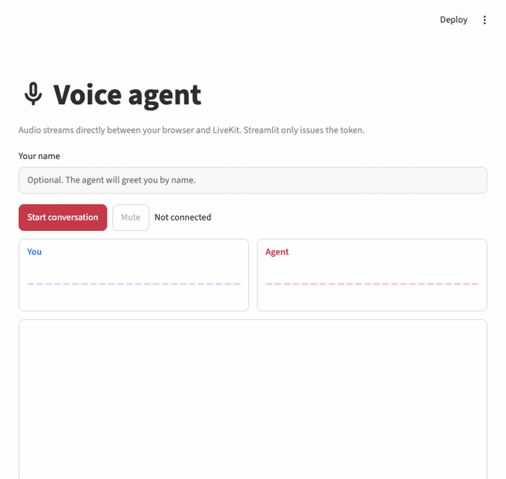

# streamlit-livekit

`streamlit-livekit` is a Python library that adds real-time voice conversations with a [LiveKit](https://livekit.io/) agent to your [Streamlit](https://streamlit.io/) app.



`voice_agent()` is a Python function that connects your Streamlit app to a LiveKit voice agent. It is built with [Streamlit custom components (v2)](https://docs.streamlit.io/develop/api-reference/custom-components/st.components.v2.component) and renders:

- Start and End buttons plus a Mute button.
- Audio meters for you and for the agent, along with the agent's state (listening, thinking, speaking).
- A live transcript.

It follows the app's light, dark, or custom theme.

Audio streams directly between the browser and LiveKit through [`livekit-client`](https://github.com/livekit/client-sdk-js). Python only creates the access token. That token dispatches your agent to a fresh room for each conversation.

## Installation

```console
pip install streamlit-livekit
```

It needs Python 3.10+ and Streamlit 1.51+. You also need a [LiveKit Cloud](https://cloud.livekit.io/) project (or a self-hosted LiveKit server) and an agent built with [LiveKit Agents](https://docs.livekit.io/agents/).

## Usage

```python
import streamlit as st
from streamlit_livekit import voice_agent

# "my-agent" is the name your agent registers under on LiveKit. You choose it
# in the agent's code, e.g. @server.rtc_session(agent_name="my-agent").
# LiveKit sends the agent with that name into each new conversation, so the
# two must match. Otherwise no agent joins and the panel keeps waiting.
result = voice_agent("my-agent")

st.write(result.state)  # "idle" | "connecting" | "connected" | "ended"
st.write(result.transcript)  # [{"role": "user" | "agent", "text": "..."}]

# Let the user save the conversation
st.download_button("Export transcript", result.to_text(), file_name="transcript.txt")
```

Credentials come from `LIVEKIT_URL`, `LIVEKIT_API_KEY`, and `LIVEKIT_API_SECRET`, or from the `url`, `api_key`, and `api_secret` arguments.

### Talking to an agent on your machine

`lk agent dev` registers under a random `dev-...` deployment unless you name one. Name it, and pass the same name to `voice_agent()`:

```console
lk agent dev --deployment local-dev
```

```python
voice_agent("my-agent", deployment="local-dev")
```

Leave `deployment` empty to reach the production deployment on LiveKit Cloud.

### Passing context to your agent

Send anything the agent should know as `metadata`, such as the user's name, a persona picked in the sidebar, or the app's settings:

```python
name = st.text_input("Your name")
persona = st.selectbox("Persona", ["Friendly", "Concise", "Pirate"])

voice_agent("my-agent", metadata={"user_name": name, "persona": persona})
```

The dict goes to the agent as JSON job metadata when a conversation starts. Read it in the agent's entrypoint:

```python
import json


@server.rtc_session(agent_name="my-agent")
async def my_agent(ctx: JobContext):
    context = json.loads(ctx.job.metadata or "{}")
    user_name = context.get("user_name")
    ...
```

Metadata is fixed when a conversation's room is created, because that's when LiveKit dispatches the agent. If it changes while the panel is idle, the panel switches to a fresh token right away. If it changes during or after a conversation, the live call is left alone and the new value applies to the next conversation.

[LiveKit simulations](https://docs.livekit.io/testing/simulations/) can't set job metadata. To keep an agent that reads it testable, put the same values in the scenario's `userdata` and read them from `ctx.simulation_context()` during a simulation.

## API

`voice_agent(agent_name, *, deployment="", metadata=None, url=None, api_key=None, api_secret=None, room_prefix="streamlit", token_ttl=timedelta(minutes=15), key="voice_agent")`

It returns a `VoiceAgentResult` with these fields:

| Field / method | Description |
|---|---|
| `state` | `"idle"`, `"connecting"`, `"connected"`, or `"ended"` |
| `transcript` | Final lines so far, as `[{"role": "user" \| "agent", "text": ...}]` |
| `room` | The LiveKit room for the current conversation |
| `to_text()` | The transcript as plain text, one `You:` or `Agent:` line per turn |

Each conversation gets its own room, because LiveKit only dispatches an agent when a room is created. The panel's "New conversation" button asks Python for a fresh room and token.

## Example app

[`example/streamlit_app.py`](example/streamlit_app.py) is a complete page with transcript export. Copy `example/.streamlit/secrets.toml.example` to `secrets.toml`, fill in your LiveKit credentials, start your agent, and run:

```console
cd example
streamlit run streamlit_app.py
```

## Development

```console
git clone https://github.com/dataprofessor/streamlit-livekit
cd streamlit-livekit
uv sync
uv run streamlit run example/streamlit_app.py
```

The component lives in [`streamlit_livekit/`](streamlit_livekit/): the Python API is in `__init__.py`, and the browser side is in `frontend/` (HTML, CSS, and JS). Streamlit serves the CSS and JS from the `asset_dir` declared in `streamlit_livekit/pyproject.toml`. It picks up JS and CSS edits on reload, but changes to the Python code need a restart of `streamlit run`.

Run the tests with `uv run pytest`, and format and lint with `uv run ruff format` and `uv run ruff check`.

## Notes

- The browser loads `livekit-client` from jsDelivr the first time you start a conversation.
- Microphone access needs a secure context: `localhost` or HTTPS.
- `result.transcript` gets only final lines, so Streamlit doesn't rerun on every partial word. The panel itself shows the partial words as they arrive.

## License

MIT
